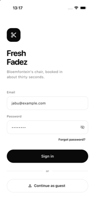
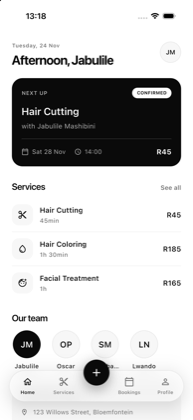
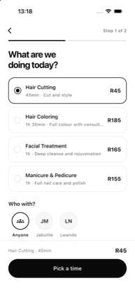
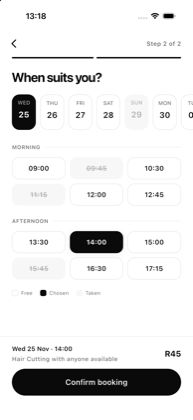
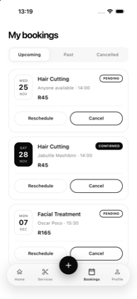
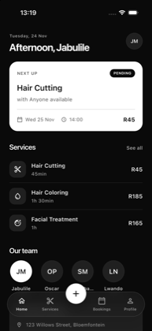
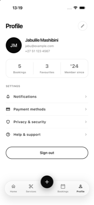

# Fresh Fadez

[](https://github.com/Jabulile1704/fresh_fadez/actions/workflows/ci.yml)

A salon booking app for **After8 Hair Salon** in Bloemfontein, South Africa.

Clients pick a service, choose a stylist, see the chair's real free slots and
book in about thirty seconds. Behind it sits a REST API whose availability
engine works out what is genuinely bookable — business hours, each stylist's
working week, time off and the existing diary — and where double-booking is
prevented by a database constraint rather than a hopeful check.

Two halves, one repository:

- **`lib/`** — a Flutter client, strictly black and white, with an iOS-style
  frosted glass bottom bar.
- **`server/`** — a Node + Express + TypeScript API on PostgreSQL.

---

## Screenshots

| Sign in | Home | Services |
|:--:|:--:|:--:|
|  |  |  |
| The wordmark, two fields and a black pill. Nothing else. | Your next appointment on a black card, then the price list and the team. | The full price list, grouped by category. |

| Book — service | Book — time | My bookings | Dark mode |
|:--:|:--:|:--:|:--:|
|  |  |  |  |
| Step 1 — what, and who with. "Anyone available" is a real choice. | Step 2 — closed days greyed, taken slots struck through, chosen slot filled. | Upcoming, Past and Cancelled, with reschedule and cancel. | The whole palette inverts; the book button goes white. |

<p align="center">
  
</p>

---

## The design

**Strictly monochrome — there is no accent colour anywhere.** That forced one
decision worth calling out: **status is carried by fill and weight, not hue.**

| State | How it reads |
|---|---|
| Confirmed | Solid black pill, filled date block |
| Pending | Outlined pill, outlined date block |
| Taken / cancelled | Muted grey, struck through |

This is more robust than colour. It survives colour-blindness, it survives
bright Free State sunlight through a shop window, and it satisfies WCAG 1.4.1
without needing a second cue bolted on later.

**Greyscale ramp.** `#6B6B6B` is the lightest grey allowed to carry words —
5.25:1 on white. `#ABABAB` is for hairlines and disabled states only, never
for text someone has to read.

**The glass bar floats.** It is inset 18px from the sides and lifted 20px off
the bottom, so content visibly passes underneath it. A blurred bar sitting
flush against a white page just reads as flat grey; the gap is what sells the
effect. The raised centre button sits outside the clip, and the shadow sits
outside the blur, because `ClipRRect` would otherwise eat both.

---

## Status

Honest about what is and is not built.

| | State |
|---|---|
| Monochrome UI, glass navigation | ✅ Built |
| Two-step booking flow | ✅ Built |
| REST API: auth, catalogue, availability, bookings | ✅ Built, 41 tests passing |
| Double-booking prevention | ✅ Enforced by a Postgres exclusion constraint |
| Flutter data layer (models, client, repositories) | ✅ Built |
| **App talking to the live API** | ⬜ Sprint 2 — the client still reads sample data |
| **Real sign-in** | ⬜ Sprint 2 — currently simulated |
| Staff / admin dashboard | ⬜ Sprint 3 |
| Notifications and payments | ⬜ Sprint 4 |
| Deployed to Render | ⬜ Open ([#10](https://github.com/Jabulile1704/fresh_fadez/issues/10)) |

---

## Architecture

### The client (`lib/`)

```
lib/
├── data/
│   ├── api/             → Dio client, token storage, typed exceptions
│   ├── repositories/    → Auth, Catalog, Availability, Appointment
│   └── sample_data.dart → stand-in data, in the API's own shapes
├── models/              → freezed models matching the API contract
├── providers/           → Riverpod wiring
├── screens/             → login, home, services, booking, bookings, profile
├── utils/               → palette, theme, money
└── widgets/             → glass nav, cards, avatars, status pills
```

Two details that matter:

- **The models are written against the API's declared contract**
  (`server/src/lib/serialize.ts`), so a field rename on either side is a
  compile error rather than a runtime null.
- **The client refreshes tokens once and replays the request on a 401, and
  concurrent 401s share a single refresh.** Without that, several screens
  loading at once each fire a refresh and race to invalidate each other's
  rotated token.

### The API (`server/`)

```
server/src/
├── availability/   → the slot engine (pure, separately testable)
├── lib/            → booking transaction, errors, serialisers, tokens
├── middleware/     → auth and error handling
└── routes/         → auth, services, stylists, availability, appointments, staff
```

**`GET /availability`** is the core of the product; everything else is CRUD
around it. It computes free slots as business hours ∩ the stylist's schedule,
minus time off, minus the existing diary, stepped by the service's duration
and excluding anything inside the booking lead time.

**Double-booking is structurally impossible.** `POST /appointments` runs in a
transaction guarded by a PostgreSQL `btree_gist` exclusion constraint on
(stylist, time range). A read-then-write "is this slot free?" check races and
will eventually lose; a constraint cannot. There is a concurrency test that
fires eight simultaneous bookings at one slot and asserts exactly one wins.

Money crosses the wire as integer **cents** and times as **ISO 8601 UTC**.

---

## Tech stack

| Layer | Choice |
|---|---|
| Client | Flutter 3.47, Dart, Material 3 |
| State | Riverpod |
| Models | freezed + json_serializable |
| HTTP | Dio, `flutter_secure_storage` for tokens |
| API | Node 22, Express, TypeScript |
| Database | PostgreSQL 16 via Prisma |
| Auth | JWT access + rotating refresh tokens, Argon2 hashing |
| CI | GitHub Actions |

---

## Getting started

### The app

```bash
flutter pub get
dart run build_runner build
flutter run
```

### The API

Needs PostgreSQL running locally.

```bash
cd server
npm install
cp .env.example .env     # then set DATABASE_URL and the two JWT secrets
npx prisma migrate deploy
npm run seed
npm run dev
```

Point the app at it with a `--dart-define`:

```bash
flutter run --dart-define=FF_API_BASE_URL=http://localhost:8080
```

---

## Testing

```bash
flutter test                  # 17 tests — models, money, widgets
cd server && npm test         # 41 tests — availability engine, concurrency
```

The server's database tests **skip themselves** when `TEST_DATABASE_URL` is
unset. That is convenient locally and dangerous in CI, so the CI job greps for
the skip message and fails on it — a green tick that tested nothing is worse
than a red one.

CI runs on every pull request: format, codegen freshness, `analyze
--fatal-infos`, and both test suites, the server's against a `postgres:16`
service container.

---

## Project management

Planned as seven two-week sprints on a
[GitHub Project board](https://github.com/users/Jabulile1704/projects/8),
with 44 issues.

| Sprint | Focus |
|---|---|
| 0 | Foundations & UI |
| 1 | Backend & data layer |
| 2 | Real auth & live booking |
| 3 | Staff & admin dashboard |
| 4 | Notifications & payments |
| 5 | Trust, support & accessibility |
| 6 | Quality & release |

A backlog holds the unscheduled work: reviews and ratings, a waitlist to
refill cancellations, loyalty, calendar integration, multi-language support
for Sesotho and Afrikaans, and guest booking.

---

## Notes for later

Two decisions recorded here so they are not rediscovered the hard way:

- **PayPal cannot receive ZAR directly in South Africa.** A merchant receives
  in a foreign currency and withdraws via a linked FNB account, with
  conversion costs. On a R45 haircut the fees may outweigh the convenience —
  PayFast, Yoco and Paystack settle ZAR locally and are the realistic choices.
- **POPIA applies.** The app holds client names, phone numbers and visit
  history, so consent capture, data export and account deletion are
  requirements rather than nice-to-haves.

---

## Author

**Jabulile Mashibini** —
[GitHub](https://github.com/Jabulile1704) ·
[LinkedIn](https://linkedin.com/in/jabulile-mashibini) ·
[Portfolio](https://jabulile1704.github.io/JM-Mashibini-Website-Portfolio-/)
